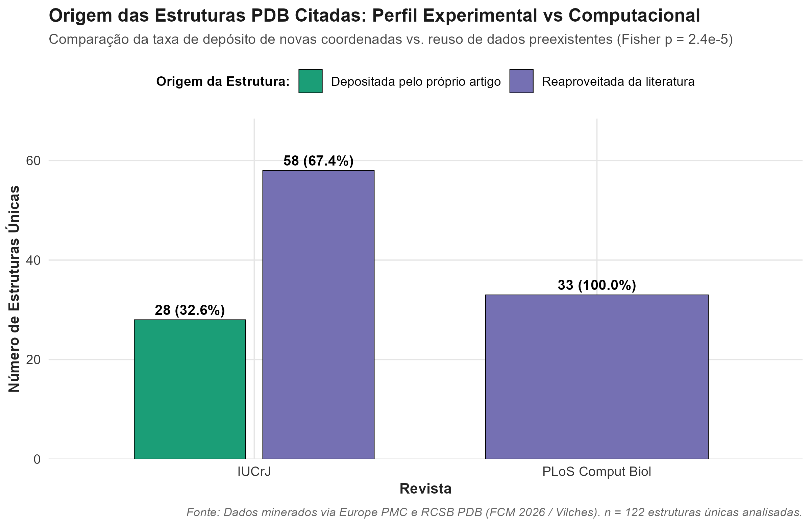
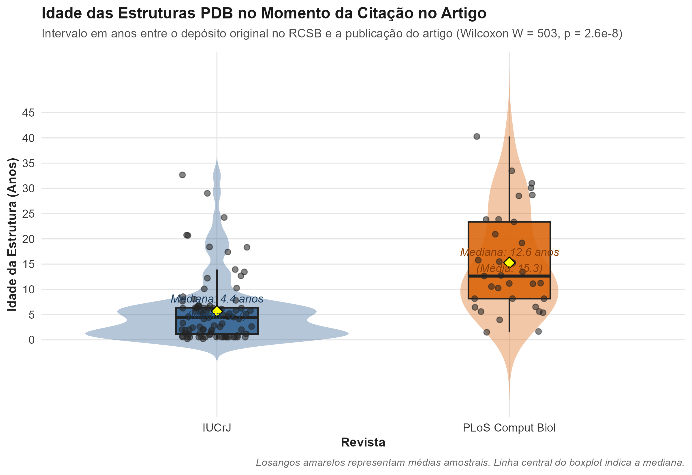
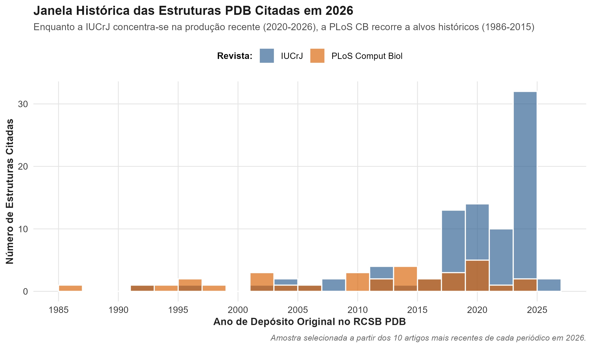
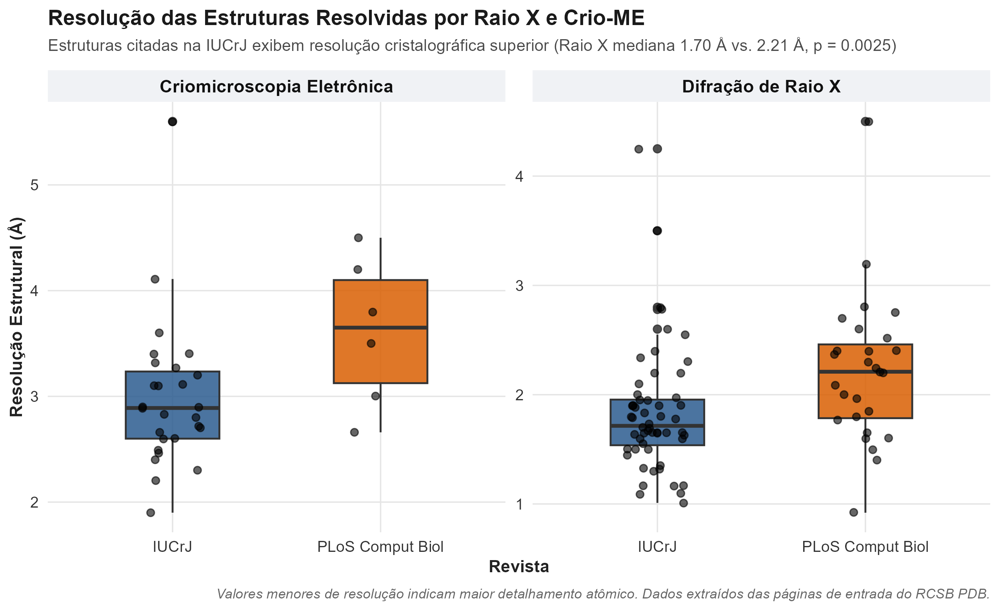
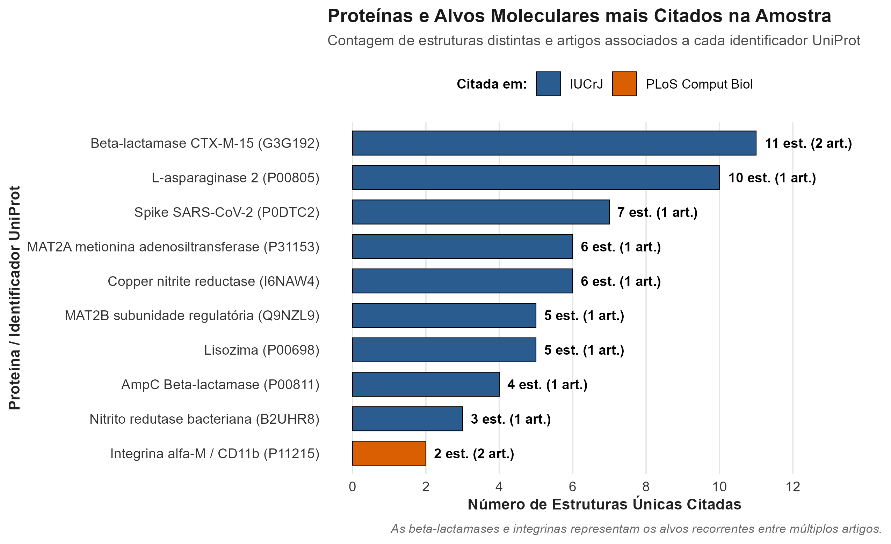
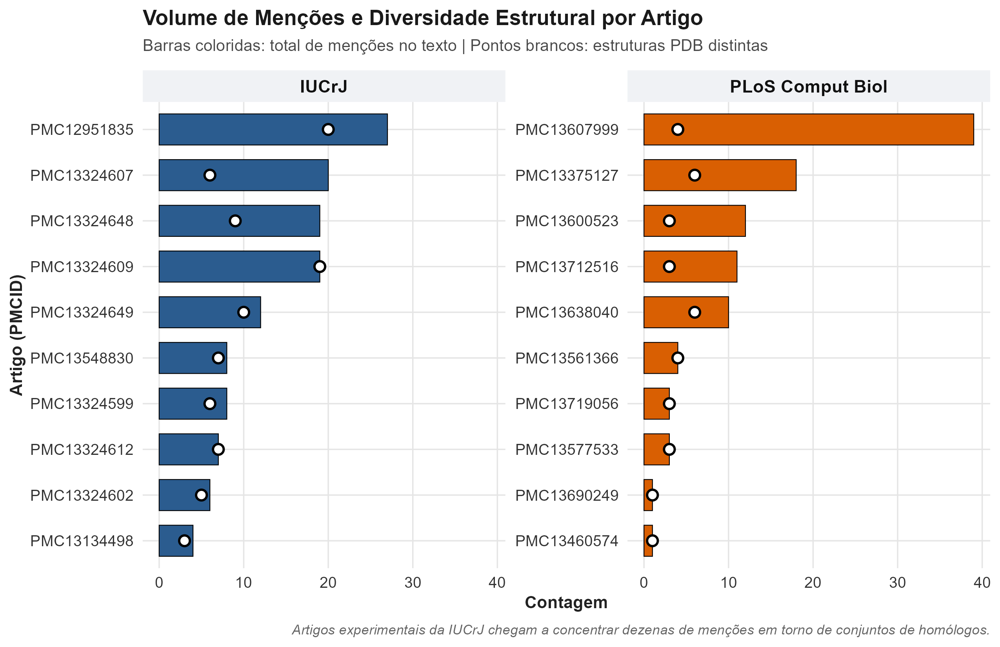

# Do artigo ao banco de dados: estruturas do PDB citadas na literatura recente

**Disciplina:** Tópicos em Informática em Saúde e Bancos de Dados (FCM 2026)  
**Docente:** Prof. Dr. Thomas Nogueira Vilches  
**Discentes:**  
- José Victor Orlandi (gráficos, análise, relatório e apresentação)  
- Ricardo de Paiva Caetano (seleção de artigos, download de PDFs, regex e scraping)  
- Pedro Yuji Yashima (modelagem relacional SQL e integração no tidyverse)  

---

## 1. Introdução

O Protein Data Bank (PDB) reúne coordenadas tridimensionais de macromoléculas biológicas determinadas experimentalmente desde 1971 (BERMAN et al., 2000). O acervo central administrado pelo consórcio mundial ultrapassou recentemente 220 mil entradas experimentais consolidadas e integradas a predições de inteligência artificial (BURLEY et al., 2023, 2025). No entanto, a base de dados isolada registra apenas o histórico cumulativo de depósitos, sem indicar o uso efetivo ou a frequência com que essas estruturas são mobilizadas pela comunidade científica contemporânea. Enquanto certas coordenadas permanecem sem novas citações após o depósito original, estruturas canônicas continuam servindo de base contínua para simulações de dinâmica molecular, ensaios de atracamento ligante-receptor (*docking*) e calibração de modelos biofísicos.

A literatura primária fornece o registro mais fidedigno desse consumo. Quando autores citam um código PDB no corpo de um artigo, estabelecem uma relação direta e funcional entre aquela estrutura e uma investigação biológica em curso (FERGUSON et al., 2021; ROSONOVSKI et al., 2024).

Periódicos científicos, contudo, respondem a culturas metodológicas distintas:
- **Periódicos experimentais (ex.: IUCrJ):** concentram trabalhos dedicados à determinação de novas estruturas atômicas por difração de raios X e criomicroscopia eletrônica (Crio-ME) (DE LA CRUZ; ENG, 2023). Seus artigos operam predominantemente como geradores primários de coordenadas inéditas.
- **Periódicos computacionais (ex.: PLoS Computational Biology):** dedicam-se a modelos teóricos, simulações biofísicas, biologia de sistemas e predições computacionais (ABRAMSON et al., 2024; VARADI et al., 2024). Seus artigos atuam majoritariamente como usuários secundários de coordenadas pré-existentes.

O objetivo deste trabalho foi implementar um pipeline automatizado em linguagem R para extrair códigos PDB citados em artigos de acesso aberto publicados em 2026 em ambos os periódicos. O sistema recupera metadados do RCSB PDB por raspagem web, persiste as informações em um banco relacional PostgreSQL normalizado em Terceira Forma Normal (3FN) e compara quantitativamente as taxas de depósito, a idade dos dados, os métodos biofísicos e as proteínas mais exploradas pela comunidade.

---

## 2. Metodologia e engenharia de dados

O pipeline foi estruturado em módulos independentes em linguagem R (WICKHAM et al., 2019):

```
[Europe PMC API] -> [AWS S3 Bucket (PMC-OA)] -> [Mineração Regex nos PDFs]
                                                        │
                                                        ▼
[Banco PostgreSQL (Schema pdb)] <- [Tidyverse / DBI] <- [Scraping RCSB PDB]
```

### 2.1. Seleção dos artigos (`00_selecionar_artigos.R`)
O script consulta a API REST da Europe PMC (ROSONOVSKI et al., 2024), aplicando os filtros:
- `JOURNAL`: "IUCrJ" ou "PLoS Computational Biology"
- `OPEN_ACCESS: y`
- `ACCESSION_TYPE: pdb`
- Ordenação decrescente pela data de publicação, com desempate pelo PMCID mais recente.

Para cada registro, o script consulta o endpoint de anotações automatizadas (`/annotations`) da Europe PMC (FERGUSON et al., 2021). A amostragem fixou os 10 primeiros artigos de cada periódico que continham pelo menos 3 códigos PDB citados no texto, totalizando 20 manuscritos analisados. Implementou-se repetição exponencial com até 3 tentativas para contornar oscilações de conexão.

### 2.2. Obtenção dos textos completos (`01_baixar_pdfs.R`)
Como o portal web do PubMed Central limita requisições automatizadas diretas, os textos completos foram obtidos do repositório público em nuvem do PMC Open Access na AWS S3 (`pmc-oa-opendata.s3.amazonaws.com`). O script identifica o arquivo PDF principal de cada artigo, ignorando anexos suplementares, e faz o download com taxa controlada de 2 segundos entre requisições. Arquivos locais já existentes na pasta `pdfs/` são preservados sem re-download.

### 2.3. Mineração de texto e extração de códigos PDB (`02_extrair_pdb.R`)
O padrão alfanumérico clássico de um código PDB é formado por 4 caracteres: um dígito inicial entre 1 e 9 seguido por 3 letras ou algarismos (BERMAN et al., 2000). A aplicação direta da expressão regular `[1-9][a-zA-Z0-9]{3}` sobre o texto extraído por `pdftools` acarreta elevado índice de falsos positivos, capturando anos cronológicos (`2026`), modelos de equipamentos (`LC-20AD`), unidades físicas (`100ms`, `10mJ`) e números ordinais (`2nd`, `3rd`).

Para mitigar o ruído, adotaram-se as regras:
1. Exigência de ao menos um caractere alfabético entre as 3 posições finais, descartando anos e números inteiros de 4 dígitos.
2. Filtro contextual de proximidade: o termo só é registrado se palavras-chave estruturais (*PDB, accession, entry, structure, coordinates, deposition*) ocorrerem na mesma linha ou até 6 linhas acima no PDF.
3. Tratamento de seções específicas da IUCrJ, em que o bloco "PDB references: ... Supporting information" do resumo é capturado na íntegra.
4. Remoção morfológica de sufixos ordinais e unidades de medida laboratoriais.

### 2.4. Enriquecimento de metadados no RCSB PDB (`03_scraping_pdb.R`)
Para cada código único catalogado, o script acessa `https://www.rcsb.org/structure/<codigo>` com a biblioteca `rvest`. Como a interface do RCSB PDB disponibiliza identificadores de elementos consistentes no HTML estático renderizado no servidor (BURLEY et al., 2023, 2025), os dados foram coletados sem necessidade de emuladores headless.

A extração estruturou duas tabelas:
- **Tabela de estruturas (`estruturas.csv`):** título, classificação macromolecular, organismo de origem, método experimental (difração de raios X, criomicroscopia eletrônica, RMN), resolução nominal em Ångströms (Å), data de depósito original, massa molecular (kDa), número de cadeias proteicas únicas e o DOI da publicação original associada (`#pubmedDOI`).
- **Tabela de entidades proteicas (`entidades.csv`):** desdobramento das subunidades individuais (tabelas `#table_macromolecule-protein-entityId-N`), recuperando nome da molécula, organismo da cadeia, código UniProt, símbolo do gene e número de classificação enzimática (EC).

A coleta manteve pausas de 2 segundos entre páginas. Entradas não encontradas (erro 404) ou embargadas/não liberadas (como o código `5WH0`) foram registradas em `codigos_nao_encontrados.csv` e não são consultadas em rodadas futuras.

### 2.5. Modelagem relacional e carga SQL (`04_banco_sql.R` e `sql/01_criar_tabelas.sql`)
Os dados foram persistidos no PostgreSQL dentro do schema dedicado `pdb`. O modelo implementou a Terceira Forma Normal (3FN), seguindo as convenções da disciplina com prefixos `ref_` para tabelas de domínio e `tab_` para tabelas de dados (SILBERSCHATZ; KORTH; SUDARSHAN, 2020; VILCHES, 2026):

```
[ref_revista] (id_revista, nome_revista)
      │ 1
      ▼ N
[tab_artigo] (id_artigo, revista_id, pmcid, doi, data_publicacao, titulo)
      │ 1
      ▼ N
[tab_mencao] (id_mencao, artigo_id, estrutura_id, n_mencoes, contexto)
      ▲ N
      │ 1
[tab_estrutura] (id_estrutura, codigo_pdb, encontrada, metodo, resolucao, data_deposito, ...)
      │ 1
      ▼ N
[tab_entidade] (id_entidade, estrutura_id, entidade, molecula, organismo, gene, ec)
      │ 1
      ▼ N
[tab_entidade_uniprot] (entidade_id, uniprot_id)
      ▲ N
      │ 1
[ref_uniprot] (id_uniprot, uniprot)
```

As chaves primárias utilizam `GENERATED ALWAYS AS IDENTITY`. A relação N:M entre entidades macromoleculares e identificadores UniProt foi resolvida por meio da tabela associativa `tab_entidade_uniprot`, permitindo armazenar proteínas quiméricas com múltiplos domínios ou anticorpos sem UniProt associado. A carga foi executada via `DBI` e `RPostgres`, utilizando a função `trocar_id()` para resolução das chaves estrangeiras.

---

## 3. Resultados e discussão

A análise dos 20 manuscritos mais recentes de 2026 resultou em 126 menções a 122 estruturas PDB únicas válidas. Uma única estrutura foi classificada como não liberada pelo PDB.

### 3.1. Taxa de depósito de novas estruturas versus reaproveitamento
Para verificar se uma estrutura citada correspondia a coordenadas geradas pelo próprio artigo estudado ou a dados preexistentes, cruzamos o DOI do manuscrito com o DOI cadastrado no PDB (`LOWER(doi_artigo) == LOWER(doi_estrutura)`).

| Periódico | Artigos | Menções | Estruturas únicas | Depositadas pelo artigo | Reaproveitadas | Taxa de depósito |
|---|:---:|:---:|:---:|:---:|:---:|:---:|
| **IUCrJ** | 10 | 92 | 89 | 30 | 58 | **34,1%** |
| **PLoS Comput Biol** | 10 | 34 | 33 | 0 | 33 | **0,0%** |
| **Total** | 20 | 126 | 122 | 30 | 91 | **24,8%** |



Na IUCrJ, 34,1% das estruturas citadas foram depositadas pelos próprios autores do trabalho (Tabela 1 e Figura 1). As 65,9% restantes representam referências a homologias, mutantes de controle ou comparadores cristalográficos da mesma família proteica. 

Na PLoS Computational Biology, **nenhuma das estruturas citadas foi depositada pelo próprio artigo** (0,0% de depósitos novos); todas as 33 estruturas identificadas foram reutilizadas de trabalhos anteriores. O Teste Exato de Fisher (FISHER, 1922; AGRESTI, 2018) confirmou a significância estatística dessa diferença ($p = 2,43 \times 10^{-5}$), evidenciando a natureza primariamente consumidora da literatura computacional em biologia estrutural.

### 3.2. Idade das estruturas citadas e inércia computacional
Calculou-se a idade de cada estrutura no momento da citação como a diferença em anos entre a data de depósito no PDB e a publicação do artigo em 2026.

| Métrica temporal (anos) | IUCrJ | PLoS Comput Biol | Teste inferencial |
|---|:---:|:---:|:---:|
| **Média** | 5,66 anos | 15,33 anos | — |
| **Mediana** | **4,40 anos** | **12,63 anos** | Wilcoxon $W = 503$ |
| **Intervalo (mínimo - máximo)** | 0,19 a 32,7 anos | 1,49 a 40,3 anos | **$p = 2,61 \times 10^{-8}$** |
| **Depósito mais antigo** | 02/07/1993 | 31/03/1986 | — |



O teste de postos sinalizados de Wilcoxon-Mann-Whitney (MANN; WHITNEY, 1947) indicou divergência temporal acentuada entre os periódicos ($p = 2,61 \times 10^{-8}$). Enquanto a IUCrJ analisa alvos recentes (mediana de 4,4 anos, com forte concentração no quinquênio 2020 a 2026), a PLoS Computational Biology ancora suas investigações em estruturas com mediana de **12,6 anos**, incluindo dados depositados em março de 1986 (há quatro décadas).

Essa discrepância reflete os requisitos metodológicos de validação em bioinformática. Algoritmos de dinâmica molecular, pontuação de docking e predições conformacionais exigem conjuntos canônicos de teste (*benchmarks* consolidados), cujas propriedades físico-químicas, constantes de dissociação ($K_d, K_i$) e ensaios de mutagênese foram exaustivamente descritos e validados experimentalmente no passado. Esse acúmulo histórico gera uma inércia metodológica que mantém estruturas clássicas em circulação contínua nos periódicos computacionais.



A linha do tempo na Figura 6 confirma esse comportamento: os registros da IUCrJ concentram-se no período recente de 2020 a 2026, enquanto a PLoS Computational Biology apresenta dispersão ampla cobrindo as décadas de 1990 e 2000.

### 3.3. Métodos experimentais e resolução atômica
Avaliou-se a técnica biofísica empregada e a resolução espacial em Ångströms (em que valores numéricos menores indicam maior acurácia atômica).

| Periódico | Método | N Estruturas | Proporção | Resolução média (Å) | Resolução mediana (Å) |
|---|---|:---:|:---:|:---:|:---:|
| **IUCrJ** | Difração de raios X | 56 | 65,1% | 1,83 | **1,70** |
| | Criomicroscopia eletrônica (Crio-ME) | 30 | 34,9% | 2,94 | **2,89** |
| **PLoS Comput Biol** | Difração de raios X | 27 | 81,8% | 2,21 | **2,21** |
| | Criomicroscopia eletrônica (Crio-ME) | 6 | 18,2% | 3,61 | **3,65** |



Dois padrões emergem da Figura 3:
1. **Diferença de qualidade atômica em difração de raios X ($p = 0,00248$ no teste de Wilcoxon):** as estruturas cristalográficas na IUCrJ exibem resolução mediana de **1,70 Å**, enquanto as estruturas citadas na PLoS Computational Biology apresentam mediana de **2,21 Å**. Trabalhos cristalográficos contemporâneos utilizam rotineiramente linhas síncrotron de alto brilho e detetores de contagem direta de fótons, alcançando detalhes químicos inacessíveis quando as referências computacionais históricas foram elucidadas.
2. **Consolidação da Criomicroscopia Eletrônica:** na IUCrJ, a Crio-ME já representa **34,9%** das estruturas analisadas, com resolução mediana de 2,89 Å. Esse dado confirma a consolidação da técnica na elucidação de complexos multiproteicos intactos (DE LA CRUZ; ENG, 2023). Na PLoS Computational Biology, a Crio-ME responde por apenas 18,2% dos casos (mediana de 3,65 Å), refletindo a preferência contínua de ferramentas de docking e dinâmica molecular clássica por malhas cristalográficas rígidas de alta resolução para parametrização de potenciais empíricos.

### 3.4. Alvos moleculares recorrentes (UniProt)
O mapeamento das entidades proteicas para identificadores UniProt canônicos revelou os principais focos biológicos na literatura recente.



O alvo mais frequente na amostra foi a **Beta-lactamase de espectro estendido CTX-M-15** (`UniProt: G3G192`), citada em 2 artigos distintos e associada a **11 estruturas PDB diferentes**. As enzimas da família CTX-M são centrais na epidemiologia de resistência a antibióticos beta-lactâmicos em bactérias Gram-negativas, justificando o esforço contínuo de cristalografia com novos inibidores e mutantes de escape (HUSNA et al., 2023).

Outros alvos com múltiplos depósitos incluem:
- **Integrina alfa-M / CD11b** (`UniProt: P11215`): receptor transmembrana participante da adesão de leucócitos e processos inflamatórios crônicos.
- **L-asparaginase 2** (`UniProt: P00805`): enzima terapêutica empregada no tratamento de leucemia linfoblástica aguda, alvo de investigações sobre o mecanismo catalítico de ataque nucleofílico.
- **Glicoproteína Spike do SARS-CoV-2** (`UniProt: P0DTC2`): com 7 estruturas de Crio-ME, avaliando rearranjos conformacionais cooperativos no trímero viral.
- **Complexo MAT2A/MAT2B** (`P31153` e `Q9NZL9`): enzimas reguladoras do ciclo da metionina em humanos, investigadas sob inibição alostérica.

### 3.5. Densidade de menções por publicação individual
A distribuição individual de citações estruturais é apresentada na Figura 5.



Enquanto manuscritos da PLoS Computational Biology citam tipicamente de 3 a 5 estruturas bem delimitadas como modelos de simulação, artigos da IUCrJ frequentemente ultrapassam 20 códigos PDB em um único manuscrito. Essa densidade ocorre principalmente em ensaios de triagem cristalográfica com múltiplos fragmentos químicos (*fragment-based screening*), nos quais dezenas de complexos da mesma enzima com ligantes distintos são depositados simultaneamente, ou em revisões técnicas detalhando arquiteturas macromoleculares completas.

---

## 4. Cuidados e limitações metodológicas

Durante o desenvolvimento do trabalho, identificamos e tratamos desafios característicos de dados bibliográficos e bases públicas:

1. **Inconsistência de caixa em identificadores DOI:** a API da Europe PMC retorna DOIs em letras minúsculas (`10.1107/s2052252526005658`), enquanto o PDB registra o DOI original frequentemente com letras maiúsculas no prefixo da editora. A integridade relacional exigiu padronização com `tolower()` no R e `LOWER()` nas consultas SQL.
2. **Entidades quiméricas e anticorpos sintéticos:** anticorpos monoclonais e construções quiméricas produzem registros na tabela de entidades sem correspondência direta no UniProt. A modelagem comportou essas exceções por meio da tabela associativa `tab_entidade_uniprot` e junções à esquerda (`LEFT JOIN`), evitando o descarte indevido de subunidades.
3. **Erros tipográficos nos textos originais:** publicações reais contêm erros de digitação dos próprios autores. Identificou-se um caso em que o código `9YRD` (estrutura de RNA) foi citado em artigo dedicado a beta-lactamases bacterianas, tratando-se provavelmente de uma troca de letras pelo código real `9RYD`. O pipeline preservou o registro documental e a divergência biológica tornou-se evidente na etapa de anotação.
4. **Estruturas não liberadas ou embargadas:** entradas cadastradas sem coordenadas liberadas pelo PDB (como o código `5WH0`) foram tratadas pelo raspador e marcadas com `encontrada = FALSE` no banco, excluindo-as do cálculo de resoluções nominais e idades.
5. **Independência amostral e dados agrupados:** as estruturas citadas no interior de um mesmo artigo compartilham o mesmo desenho experimental e autores, constituindo observações correlacionadas (*clustered data*). Em uma expansão formal para publicação, o ajuste adequado de idade e resolução demandaria Modelos Lineares Generalizados Mistos com efeito aleatório por publicação (`1 | pmcid`) (HARRISON et al., 2018).

---

## 5. Conclusões

O pipeline construído em linguagem R e banco relacional PostgreSQL cumpriu as exigências da disciplina FCM 2026, integrando consultas a APIs bibliográficas, download em repositório em nuvem, extração textual por expressões regulares com filtros de proximidade, raspagem estruturada no RCSB PDB e persistência relacional normalizada em 3FN.

Os resultados obtidos sobre os dados recentes de 2026 comprovam a complementaridade de papéis na biologia estrutural: periódicos experimentais (IUCrJ) atuam como os principais geradores de coordenadas inéditas de alta resolução espacial (34,1% de novos depósitos; mediana de 4,4 anos de idade; resolução de raios X de 1,70 Å), ao passo que periódicos computacionais (PLoS Computational Biology) operam na reutilização de dados (0,0% de depósitos novos; mediana de 12,6 anos, com estruturas de até 40 anos), refletindo a necessidade contínua de benchmarks consolidados e historicamente validados para calibração de modelos biofísicos e preditivos.

O código-fonte, o esquema relacional e as bases consolidadas estão disponíveis publicamente em:  
[https://github.com/paivacaetano126/TrabalhoPDB](https://github.com/paivacaetano126/TrabalhoPDB).

---

## 6. Referências

ABRAMSON, J. et al. Accurate structure prediction of biomolecular interactions with AlphaFold 3. **Nature**, London, v. 630, n. 8016, p. 493-500, 2024. DOI: 10.1038/s41586-024-07487-w.

AGRESTI, A. **An Introduction to Categorical Data Analysis**. 3. ed. Hoboken: John Wiley & Sons, 2018.

BERMAN, H. M. et al. The Protein Data Bank. **Nucleic Acids Research**, Oxford, v. 28, n. 1, p. 235-242, 2000. DOI: 10.1093/nar/28.1.235.

BURLEY, S. K. et al. RCSB Protein Data Bank (RCSB.org): delivery of experimentally-determined PDB structures alongside one million computed structure models of proteins from artificial intelligence/machine learning. **Nucleic Acids Research**, Oxford, v. 51, n. D1, p. D488-D508, 2023. DOI: 10.1093/nar/gkac1077.

BURLEY, S. K. et al. Updated resources for exploring experimentally-determined PDB structures and Computed Structure Models at the RCSB Protein Data Bank. **Nucleic Acids Research**, Oxford, v. 53, n. D1, p. D564-D574, 2025. DOI: 10.1093/nar/gkae1091.

DE LA CRUZ, M. J.; ENG, E. T. Scaling up cryo-EM for biology and chemistry: The journey from niche technology to mainstream method. **Structure**, Cambridge, v. 31, n. 12, p. 1475-1488, 2023. DOI: 10.1016/j.str.2023.09.009.

FERGUSON, C. et al. Europe PMC in 2020. **Nucleic Acids Research**, Oxford, v. 49, n. D1, p. D1507-D1517, 2021. DOI: 10.1093/nar/gkaa994.

FISHER, R. A. On the interpretation of $\chi^2$ from contingency tables, and the calculation of P. **Journal of the Royal Statistical Society**, London, v. 85, n. 1, p. 87-94, 1922. DOI: 10.2307/2340521.

HARRISON, X. A. et al. A brief introduction to mixed effects modelling and multi-model inference in ecology. **PeerJ**, v. 6, p. e4794, 2018. DOI: 10.7717/peerj.4794.

HUSNA, A. et al. Extended-Spectrum β-Lactamases (ESBL): Challenges and Opportunities. **Biomedicines**, Basel, v. 11, n. 11, p. 2937, 2023. DOI: 10.3390/biomedicines11112937.

MANN, H. B.; WHITNEY, D. R. On a test of whether one of two random variables is stochastically larger than the other. **The Annals of Mathematical Statistics**, Baltimore, v. 18, n. 1, p. 50-60, 1947. DOI: 10.1214/aoms/1177730491.

ROSONOVSKI, S. et al. Europe PMC in 2023. **Nucleic Acids Research**, Oxford, v. 52, n. D1, p. D1668-D1676, 2024. DOI: 10.1093/nar/gkad1085.

SILBERSCHATZ, A.; KORTH, H. F.; SUDARSHAN, S. **Database System Concepts**. 7. ed. New York: McGraw-Hill, 2020.

VARADI, M. et al. AlphaFold Protein Structure Database in 2024: providing structure coverage for over 214 million protein sequences. **Nucleic Acids Research**, Oxford, v. 52, n. D1, p. D376-D385, 2024. DOI: 10.1093/nar/gkad1011.

VILCHES, T. N. **Notas de aula e diretrizes da disciplina de bancos de dados**. Campinas: Faculdade de Ciências Médicas, Universidade Estadual de Campinas, 2026.

WICKHAM, H. et al. Welcome to the Tidyverse. **Journal of Open Source Software**, v. 4, n. 43, p. 1686, 2019. DOI: 10.21105/joss.01686.
